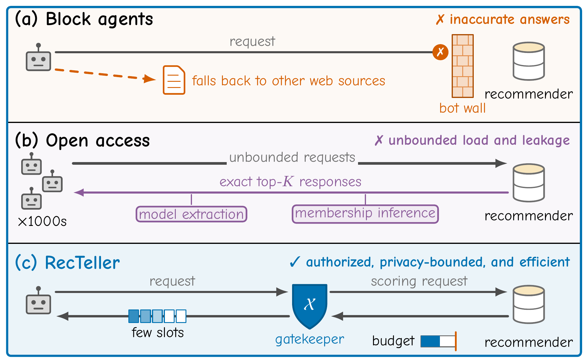
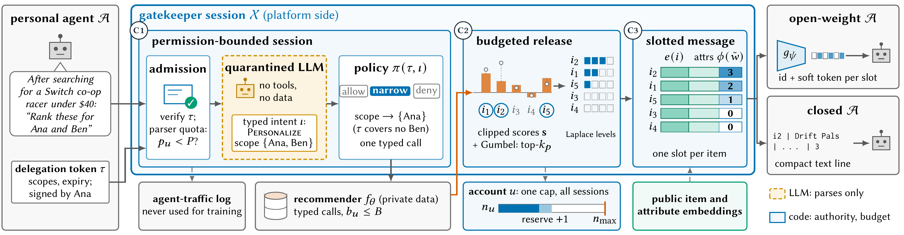

# RecTeller

Official implementation of **RecTeller: Secure and Budgeted Recommendation Access for Personal Agents**.

RecTeller lets a platform serve users' personal AI agents from its recommender while keeping load and
leakage under its own control.

<p align="center">
  
</p>

A platform-side **gatekeeper** answers agents through three components.

| Component | Paper | Code |
|---|---|---|
| **C1** Permission-bounded gatekeeper sessions: delegation tokens, per-account counters `p_u ≤ P`, `b_u ≤ B`, `n_u ≤ n_max` with atomic `Reserve`, a quarantined LLM parser that emits typed intents, and an access-control policy enforced in code | §4.1, Alg. 1 lines 1–6 | `tokens.py`, `accounts.py`, `intents.py`, `parser.py`, `policy.py`, `gatekeeper.py` |
| **C2** Budgeted release: reserve-then-release, clipped scores, one-shot Gumbel top-k_p selection, Laplace weight levels `⌈L·softmax(ŵ)⌉`, public fill and a per-account cache | §4.2, Eqs. (select)(weights), Prop. 1–2 | `release.py`, `gatekeeper.py` |
| **C3** Compact transport through slotted messages `z_k = [e(o_k) ‖ Σα e(v) ‖ φ(level)]` over public embeddings, read by open-weight agents as "`[id]` + one soft token" through a per-receiver projector `g_ψ`, or by any agent as compact text `id \| title \| attribute values \| level` | §4.3, Eqs. (slot)(proj) | `encoder.py`, `projector.py`, `clients.py` |

The repository also contains the full experimental pipeline: datasets and pick-one tasks, the SASRec
recommender, all access modes and controls, GRO, and the attacks (model extraction, membership
inference, floods, policy violations, repetition and long-horizon attacks).

<p align="center">
  
</p>

## Repository structure

```
recteller/
  config.py        protocol constants and paths
  data.py          Amazon Reviews 2023 (Video_Games, Industrial_and_Scientific) and MovieLens-1M,
                   leave-last-out splits, 20-candidate pick-one tasks
  needs.py         need texts written by a fixed LLM prompt from public item attributes
  sasrec.py        SASRec (platform recommender, attacker surrogate, MIA shadow model)
  tokens.py        delegation tokens (HMAC-signed)
  accounts.py      per-account counters with atomic reservation and an optional 30-day cap
  intents.py       closed typed-intent grammar
  parser.py        quarantined LLM parser (and the LLM-enforced policy of ablation A1)
  policy.py        access-control policy pi(tau, iota) in code
  retrieval.py     public retrieval C(q) and public relevance r_i(q)
  release.py       release modes: noisy | exact_kp | topK_list | random_replace
  gatekeeper.py    Algorithm 1, with batched scoring for long attacks
  encoder.py       public encoder E and slotted messages
  projector.py     per-receiver projector g_psi and its public training simulator
  llm.py           frozen open-weight LLM with soft-token input (inputs_embeds)
  clients.py       client prompts per access mode and the closed-model client
  modes.py         access modes as gatekeeper configurations
  evaluate.py      HR@1, client tokens and bootstrap intervals
  gro.py           GRO-defended recommender
  attacks/         extraction.py  mia.py  flood.py  violations.py
scripts/           training, evaluation and report scripts
tests/             unit tests
run_all.sh         end-to-end pipeline
```

## Installation

Requires Python ≥ 3.10 and a CUDA GPU with 24 GB of memory for the 8B client models.

```bash
pip install -r requirements.txt
python -m pytest -q tests/
```

Environment variables:

| Variable | Purpose | Default |
|---|---|---|
| `RECTELLER_WORK` | raw data, processed data, checkpoints and caches | `~/recteller_work` |
| `RECTELLER_RESULTS` | JSON results and the generated report | `./results` |
| `RECTELLER_CLIENT` | open-weight client and projector receiver | `Qwen/Qwen3-8B` |
| `RECTELLER_PARSER` | quarantined parser | `Qwen/Qwen3-8B` |
| `RECTELLER_ENCODER` | public text encoder (d = 768) | `sentence-transformers/all-mpnet-base-v2` |
| `OPENAI_API_KEY` | closed client (GPT-4o-mini) | – |
| `LLAMA` | second receiver for ablation A5 | `~/recteller_work/hf/Llama-3.1-8B-Instruct` |
| `RECTELLER_NEED_FEATURES` | `1`: need texts use category, price band and two features (App. C.1). `0`: coarse attributes only | `1` |
| `RECTELLER_ML_NEG_DECADE` | `1`: ML-1M negatives share the target's first genre and release decade. `0`: first genre only | `0` |
| `RECTELLER_PROJ_ANCHOR` | projector simulator proxy scores: `need` (similarity to the need text, App. D) or `target` | `need` |

## Data

```bash
# Amazon Reviews 2023: 5-core leave-last-out splits and item metadata
python -c "
from huggingface_hub import hf_hub_download as h
import os
root = os.path.expanduser('~/recteller_work/raw/amazon')
for c in ['Video_Games', 'Industrial_and_Scientific']:
    for s in ['train', 'valid', 'test']:
        h('McAuley-Lab/Amazon-Reviews-2023', f'benchmark/5core/last_out_w_his/{c}.{s}.csv', repo_type='dataset', local_dir=root)
    h('McAuley-Lab/Amazon-Reviews-2023', f'raw/meta_categories/meta_{c}.jsonl', repo_type='dataset', local_dir=root)
"

# MovieLens-1M
mkdir -p ~/recteller_work/raw && cd ~/recteller_work/raw
curl -LO https://files.grouplens.org/datasets/movielens/ml-1m.zip && unzip ml-1m.zip
```

| Dataset | Users | Items | Interactions |
|---|---|---|---|
| Games (Amazon Video_Games, 5-core) | 94,762 | 25,612 | 814,586 |
| Industrial (Amazon Industrial_and_Scientific, 5-core) | 50,985 | 25,848 | 412,947 |
| ML-1M | 6,040 | 3,416 | 999,611 |

## Running the experiments

```bash
bash run_all.sh data   # datasets, SASRec victims and shadows, GRO, need texts
bash run_all.sh llm    # projectors, RQ1 utility and cost, RQ3 trade-off, RQ4 ablations, budget, violations
bash run_all.sh sec    # RQ2 floods, extraction (1 and 50 accounts), membership inference, repetition, long attacks
bash run_all.sh gpt    # closed client on 500 tasks per dataset
python scripts/make_report.py   # writes results/REPORT.md
```

The `llm` and `sec` stages can run at the same time on one 24 GB GPU. Every script skips results that
already exist, and `--force` recomputes them.

Individual runs:

```bash
# utility and client tokens of access modes
python scripts/run_utility.py --dataset games --modes mcp iagent gro ours ours_text einf --seeds 3
python scripts/run_utility.py --dataset games --client gpt --n 500 --modes mcp ours_text

# model extraction with 50 colluding accounts over 7 days
python scripts/run_security.py extraction --dataset games --modes ours einf mcp gro --accounts 50 --seeds 5

# privacy budget: "ours@<eps_resp>" (eps_sel : eps_w = 3 : 1)
python scripts/run_utility.py --dataset games --modes ours@8 ours@16 --seeds 1
```

### Access modes

| Name | Mode |
|---|---|
| `block`, `web` | no recommender access, rendered product pages |
| `mcp`, `iagent`, `firewall` | MCP tools (top-10 + product information), user-side reranking, LLM converter + deterministic verifier |
| `gro` | GRO-defended recommender behind an unrestricted interface (exact ranked lists, no scores, no policy) |
| `ours`, `ours_text` | RecTeller read as soft tokens or as compact text |
| `einf`, `pub` | RecTeller at eps_resp = ∞, RecTeller with public slots only (k_p = 0) |
| `nocap`, `neither` | ablations − cap (per-session keying) and − noise − cap |
| `kp1`, `kp5`, `nolev` | sensitivity: k_p = 1 or 5, no weight levels (ε_w = 0, the whole budget on selection) |
| `ours_a2`, `ours_shuf`, `ours_text`, `ours_xproj`, `min` | ablations A2 (no parser, the client reads the intent schema), A3, A4, A5, and minimal (A2 + A4, no levels) |
| `capo<n>` | cap-only k_p = 3 control: noise-free release with n_max = n (the paper uses n ∈ {2, 4}) |
| `rr<p>` | random replacement: exact ranked list behind the account cap, each item replaced with probability p |
| `ours@<eps>` | RecTeller with ε_resp = eps (ε_sel : ε_w = 3 : 1), swept over {0.5, 1, 2, 4, 8, ∞} |

### Default protocol

K = 10 slots, k_p = 3 personalized slots, L = 4 levels, clip c = 5, Δ = 1, ε_sel = 3, ε_w = 1
(ε_resp = 4), and per account and 24-hour window n_max = 8, B = 40, P = 200. These are defined in
`recteller/config.py` and can be overridden through `Protocol(...)`.

## Tests

```bash
python -m pytest -q tests/
```

The tests cover the running example of the paper, an empirical check of the selection's differential
privacy, the account cap under 50 concurrent sessions, admission before the parser, the policy example,
the per-account cache, the sliding 30-day cap and grammar fuzzing.